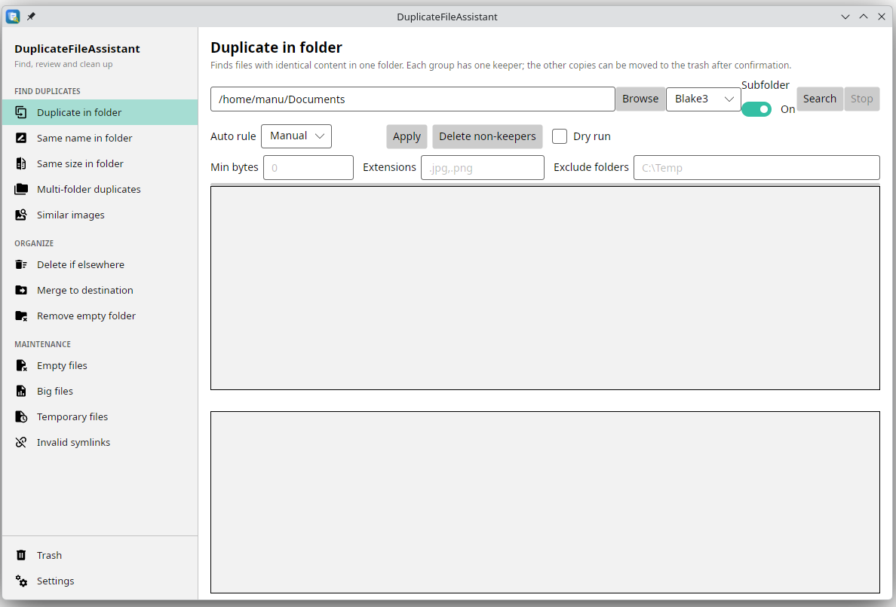

<p align="center">
  
</p>

# DuplicateFileAssistant

[](https://manuc66.github.io/DuplicateFileAssistant/)

Utility tool to find duplicate files on the system.

The application is built on top of dotnet and works at least on Windows and Linux.

Different kind of file hashing are supported as well as fast file compare with SIMD.

📖 **[Full documentation →](https://manuc66.github.io/DuplicateFileAssistant/)** — the
guide, the CLI reference, and the safety model. Published from [`docs/`](docs/); this
README is the short version.



## Safety

- Duplicate candidates are verified byte-for-byte before being offered for deletion.
- Deleted files are moved to a configurable trash folder and can be restored from the
  `Trash` tab, including after an application restart.
- The trash manifest records the original path, size, timestamps, attributes, Unix mode
  and SHA-256 hash of every entry.
- Destructive operations are confirmed, and `Delete if elsewhere` / `Merge to destination`
  provide a dry-run mode.
- `Merge to destination` never overwrites conflicts; conflicting files are left untouched.
- The trash folder is excluded from scans, and directory symlinks/reparse points are not
  followed.

The trash is a safety net against manipulation errors, not a backup. Keep an independent
backup of irreplaceable files.

## CLI

The `Cli` project provides a JSON-capable command-line frontend. Destructive commands are
dry-run by default; add `--apply` explicitly.

```bash
dotnet run --project Cli -- duplicates --path ~/Pictures --json
dotnet run --project Cli -- similar-images --path ~/Pictures --json
dotnet run --project Cli -- similar-images --path ~/Pictures --semantic --keeper-model dbcnn --json
dotnet run --project Cli -- empty-files --path ~/Downloads --json
dotnet run --project Cli -- big-files --path ~/Videos --max 20 --json
dotnet run --project Cli -- temporary --path ~/Projects --json
dotnet run --project Cli -- invalid-symlinks --path ~/data --json
dotnet run --project Cli -- empty-folders --path ~/Projects --apply
```

Common options: `--path`, `--json`, `--apply`, `--trash`, `--exclude`, `--max`,
`--algorithm sha256|md5`.

## Similar images

The desktop app has a **Similar images** tab, and the `similar-images` command exposes the
same finder. It finds near-identical pictures, for example the same photo saved at
another resolution or compression level. Each image gets a 64-bit difference hash
(dHash): it is decoded at a reduced scale, transparency is composited on white, EXIF
orientation is applied, and a 9x8 grayscale grid is compared horizontally.
Distances are measured with the Hamming distance.

- `--threshold <bits>` defaults to 8 over 64 bits.
- Images must also have a compatible aspect ratio (8% tolerance) to be grouped.
- The command is **report-only**: it never deletes files, even with `--apply`.
- Hashes are cached in `scan-cache.json`; use `--no-cache` or `--cache-path <file>`
  to change that.
- Supported formats are the SkiaSharp codecs: JPEG, PNG, GIF, BMP, WebP and ICO.
  HEIC, AVIF and camera RAW are not decoded.
- Grouping is leader-based, so a group never chains through unrelated images.

The `ImageCompare` project uses SkiaSharp, which Avalonia already ships with the
desktop application. Adding it to the CLI pulls SkiaSharp (~11 MB) and ONNX Runtime
(~15 MB) per runtime identifier, plus the models downloaded on demand.

### Semantic pass

`--semantic` adds a DINOv2-small embedding pass (Apache-2.0). It catches the same
scene **cropped or edited**, which dHash cannot. Embeddings are compared with the
cosine similarity and the grouping stays leader-based: a picture can only join an
existing group, never a member of a group, so a chain of loose matches cannot merge
unrelated images.

- `--semantic-threshold <0..1>` defaults to 0.80.
- `--semantic-margin <0..1>` defaults to 0.05. A borderline match must be clearly
  better than the second-best candidate. Obvious matches (≥ 0.94) bypass the margin,
  so three or more copies of the same picture can still join the same group.
- `--embedding <id>` selects the model; `--semantic` is shorthand for
  `--embedding dinov2-small`.
- Models are downloaded on first use to
  `%LOCALAPPDATA%/DuplicateFileAssistant/models`, verified with SHA-256, and reused
  offline. Use `--model-dir <dir>` to choose another location and `--no-download`
  to fail instead of downloading.
- The embedding cache is `embeddings-<model>.bin` next to the scan cache. Disable
  both caches with `--no-cache`.

The core `ImageCompare` project only knows `IImageEmbeddingProvider` and
`IQualityScorer`; it has no ONNX dependency. The ONNX adapter lives in
`ImageCompare.Onnx`. Adding another model is a catalog entry (URL, SHA-256,
preprocessing, output tensor, pooling) or another provider implementation; the
finder does not change.

### Suggested keeper

`--keeper` scores the technical quality of every image in a group (Laplacian
sharpness and resolution, no model). `--keeper-model dbcnn` uses DBCNN
(Apache-2.0, ~60 MB) instead. The keeper is chosen among copies that are within 5%
of the resolution of the largest member, so a 640px thumbnail can never be
suggested over the 4K original even if its quality score is higher.

Quality scoring only runs on images that already belong to a group. The result is
a suggestion: no file is moved or deleted. Similarities and distances in the report
are measured against the group **leader**, not against the keeper; the keeper can be
another member when it has a better quality score.

### Performance notes

- dHash: ~500 images/s on 3.8 MP JPEGs with 8 workers.
- DINOv2-small: ~100 ms/image single-threaded on CPU; 133 images in ~7 s with 8
  workers. An embedding cache makes later runs nearly instant.
- DBCNN: ~100 ms/image on CPU, only for images inside groups.
- Thresholds are tuned for photographs. Libraries of very uniform illustrations or
  renders may need a higher `--semantic-threshold`.
- Up to 5,000 images, semantic candidates are compared exhaustively; above that the
  finder uses an in-memory 128-bit SimHash index, which is approximate for borderline
  crops.

### Model licences

DINOv2-small and DBCNN are Apache-2.0. Model files are downloaded from Hugging Face
on demand and are not part of the repository.

## Caches

Everything expensive is persisted under `%LOCALAPPDATA%/DuplicateFileAssistant`:

| Cache | File | Contents | Invalidated by |
|---|---|---|---|
| File and perceptual hashes | `scan-cache.json` | SHA-256/MD5 and dHash values | path, length, last write time, algorithm |
| Embeddings | `embeddings-<model>.bin` | one `float[]` per image | path, length, last write time; model id in the file name |
| Quality scores | `quality-<scorer>.bin` | one score per image | path, length, last write time; scorer id in the file name |
| Models | `models/<model>/...` | ONNX files and `.verified` SHA-256 markers | SHA-256 of the downloaded file |

Not persisted, because they are cheap or derived: file enumeration, the SimHash
index, BK-trees, grouping and the final report. They are rebuilt from the caches.

The CLI can inspect and maintain the caches:

```bash
dotnet run --project Cli -- cache --json
dotnet run --project Cli -- cache --prune
dotnet run --project Cli -- cache --clear --apply
```

- `cache` lists entries and bytes per cache.
- `--prune` removes entries whose files no longer exist.
- `--clear --apply` deletes the computed caches, not the downloaded models.
- `--cache-dir <dir>` inspects another cache directory.
- `duplicates` and `similar-images` accept `--prune-cache` to prune while scanning.
- `--no-cache` disables the data caches; `--cache-path`, `--embedding-cache` and
  `--quality-cache` override individual files.

Cache entries are keyed by path, length and last write time. This is the usual
trade-off: a file modified without changing its size or timestamp (for example a
`touch -r`) can reuse a stale value. Deleting the caches is always safe.

## Storage formats

- `trash-manifest.json` stores the mutable trash index as a JSON array.
- `operations.jsonl` is an append-only audit log. JSON Lines was chosen deliberately:
  it is simple, human-readable, dependency-free and well suited to an append-only log.

This tool is still under development, use it at your own risk.